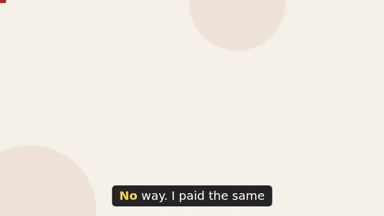
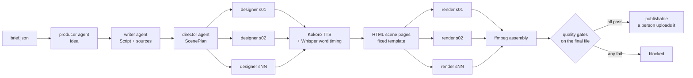

# multi-agent-video-pipeline

A small pipeline that turns a one-paragraph brief into a short explainer video,
using several LLM agents with typed contracts, local open-weight speech models,
HTML scenes rendered in headless Chrome, and **measured quality gates that block
a bad video**. Publishing stays manual: the pipeline ends with `publishable` or
`blocked`, and a person decides.

[](examples/how-to-read-an-invoice/final.mp4)

The example output, silent preview. With sound: [`examples/how-to-read-an-invoice/final.mp4`](examples/how-to-read-an-invoice/final.mp4)
(640x360, 25.6 s, committed in the repo because it is small).
**The agents' answers behind this video are replayed, hand-written references, not a live
model run** (see [Claude or replay](#claude-or-replay)).

## How this was built

This is a public reconstruction of the explainer-video production chain I use in production,
where I steer the agents and publish by hand. The production code and data stay private, so
this version runs on an invented example. I built it with Claude Code as a coding agent: I set
the architecture, the measurements and the acceptance criteria, and the agent wrote most of
the code to that brief. Every number in `results.md` is regenerated by a script, and each
guardrail is tested by breaking it on purpose.

## The problem

Generating a video with LLMs is easy. Knowing that the result is right is not:
the voice can drift from the approved script, a subtitle can lag, a scene can be
blank, text can be too small to read on a phone. Looking at every video by hand
does not scale, and "the model said it's fine" is not a check. Each of these
failures is turned here into a number, a threshold and a test.

## What it does



- **Agents with contracts.** Four roles (producer, writer, director, designer).
  Each returns JSON validated by a Pydantic model (`vidpipe/contracts.py`), plus
  cross-contract rules: every factual line cites a source, every script line
  is used once and in order, on-screen keywords must be spoken. A live agent that
  breaks its contract gets one retry with the validation error; then the run stops.
- **Parallel work.** One designer agent per scene runs in parallel; scenes are
  rendered in parallel, each in its own headless browser.
- **Resume, not restart.** Every step's validated output is cached with a hash of
  its inputs (`vidpipe/store.py`), per scene where it matters. If rendering scene 5
  crashes, the next run reuses the ideas, script, designs, voices and scenes 1-4.
  `--force STAGE` redoes a stage and everything after it.
- **Agents never write HTML.** They choose a layout, a heading and keywords; a
  fixed template does the rest. Each page exposes `window.__seek(t)`, so rendering
  is deterministic: one screenshot per frame, no wall clock.
- **Local, open models only.** Voice: [Kokoro-82M](https://huggingface.co/hexgrad/Kokoro-82M)
  (Apache-2.0, int8 ONNX, CPU). Transcription: [faster-whisper](https://github.com/SYSTRAN/faster-whisper)
  `small` (MIT, int8, CPU). No paid service is called.

### Claude or replay

The agents talk to an interchangeable provider (`vidpipe/agents/`):

- **`vidpipe run` replays** recorded outputs from `recordings/`. **Be aware:** the
  recordings shipped here were written by hand as reference answers in the agents' output
  format; no API call was made for the published example. The replay path still goes through
  the same contract validation, caching and parallel execution as a live run. Each recording
  stores the hash of the prompt it answers; `--strict-replay` refuses a recording whose prompt
  has changed.
- **`python -m vidpipe claude` is the live pass.** It prints a cost estimate (measured on the
  example's prompts, offline) and waits for a yes, then the four agents call Claude
  (`claude-haiku-5-5` by default, `VIDPIPE_CLAUDE_MODEL` to change) and the local stages turn
  their answers into a video and gate it. Answers are recorded to `recordings/<slug>-claude/`
  and the run goes to `runs/<slug>-claude/`, so the published example stays as it is. The
  result (calls, contract retries, tokens, cost, gate status) is written to
  `results/claude_pass.json`, `results.md` and the line below. Expected cost for the example:
  under one cent ($0.10 / $0.50 per million input / output tokens; at most about $0.08 if every
  agent needed its retry and every answer ran to `max_tokens`). The path is tested with a fake
  client ([tests/test_claude_pass.py](tests/test_claude_pass.py)): no `temperature`, no
  assistant prefill, retries counted, a broken contract stops the pass and is reported.

Live pass status:

<!-- claude:start -->
**Not run yet.** The published example video was made from the replayed, hand-written agent answers in `recordings/`; no live Claude call was made for it. `python -m vidpipe claude` runs the live pass and fills this section.
<!-- claude:end -->

## Quality gates

All gates are measured on the **finished file**, not on intermediate data
(`vidpipe/qc/`). The decision logic is pure and unit-tested on synthetic
measurements (`tests/test_qc_gates.py`); `tests/test_example_video.py` measures
the real example video.

| Gate | How it is measured |
|---|---|
| Voice = script | final audio transcribed locally by Whisper, with no hint from the script; word error rate over the whole video and for the worst scene |
| Durations | each scene within bounds, video under 30 s, audio and video streams the same length |
| Legible text | in headless Chrome: computed font size of every text box, WCAG contrast against its real background (alpha-composited), text inside the frame, fully opaque at rest and not covered by another element (hit-testing) |
| No empty scene | grey-level spread of each scene's middle frame, text present, ffmpeg `blackdetect` |
| Subtitles in sync | each cue's start time vs the time its first word is heard in the final audio |
| Sourced facts | every line of kind `fact` cites a source that exists |

### Guard tested by mutation

`scripts/mutation_check.py` damages the committed example in place (scene 3 now
says something off-script, with picture and durations unchanged), runs the guard
test and expects it to go red, restores the file from a backup copy (not from
git), checks the hash, and expects green again. The same scenario also runs as a
regular test on a temporary copy (`test_off_script_voice_is_blocked`).

## Measured results

Generated by `scripts/make_results.py` into [`results.md`](results.md):

<!-- results:start -->
Example video: 25.6 s, 7 scenes, status **publishable**. Mutated video (off-script voice in one scene): **blocked**.

| Gate | Measured | Threshold |
|---|---|---|
| `transcript_wer_total` | 0.0156 | 0.1 |
| `transcript_wer_worst_scene` | 0.0833 | 0.25 |
| `scene_durations` | 0.0 | 0.0 |
| `video_length` | 25.628 | 30.0 |
| `audio_video_drift` | 0.003 | 0.1 |
| `text_min_font_px` | 16.0 | 16.0 |
| `text_min_contrast` | 5.35 | 4.5 |
| `text_fully_visible` | 0.0 | 0.0 |
| `no_empty_scene` | 0.0 | 0.0 |
| `no_black_frames` | 0.0 | 0.0 |
| `subtitle_sync` | 0.235 | 0.3 |
| `facts_sourced` | 0.0 | 0.0 |
| `transcript_wer_worst_scene`, mutated video | 1.0909 | 0.25 |

Tests: unit 29 passed, 7 deselected in 0.15s; example 7 passed, 29 deselected in 15.22s.
<!-- results:end -->

## Run it

Requirements: Python 3.11, ffmpeg, Google Chrome (Playwright drives the installed
Chrome), about 1.5 GB of free RAM.

```bash
uv venv --python 3.11 .venv && uv pip install -r requirements.txt   # or pip
./scripts/fetch_models.sh                 # Kokoro model files (~120 MB), hash-checked
.venv/bin/python -m vidpipe run examples/how-to-read-an-invoice/brief.json
```

The run writes everything under `runs/<slug>/` and prints each gate; the exit code
is 0 if publishable, 2 if blocked. Other commands:

```bash
.venv/bin/python -m vidpipe qc runs/how-to-read-an-invoice     # re-measure a finished video
.venv/bin/python -m vidpipe export runs/how-to-read-an-invoice examples/how-to-read-an-invoice
ANTHROPIC_API_KEY=... .venv/bin/python -m vidpipe claude    # live pass of the agents (cost estimate first;
                                                             # --agents-only skips voice, render and QC)
.venv/bin/python -m pytest                    # unit tests (fast, no models)
.venv/bin/python -m pytest -m example         # gates on the real example video (local models)
.venv/bin/python scripts/mutation_check.py    # mutation test of the transcript guard
.venv/bin/python scripts/make_results.py      # regenerate results.md
scripts/make_preview.sh                       # regenerate docs/preview.gif from the example video
scripts/build_all.sh                          # all of the above for the example, in order
```

On a shared machine, `VIDPIPE_LOCK=/path/to/lockfile` serialises model loading
and rendering with other jobs (flock semantics).

## Layout

```
vidpipe/
  contracts.py      typed inputs/outputs of every stage
  orchestrator.py   the stage graph, parallelism, caching
  store.py          stage cache and resume
  agents/           Agent, replay and Claude providers, the four roles
  live_pass.py      the live Claude pass: cost estimate, run, results
  stages/           speech (Kokoro, Whisper), html (scene template), render (Chrome, ffmpeg)
  qc/               text (WER, alignment), checks (pure gates), measure (on the file)
  mutation.py       deliberate damage used by the guard test
recordings/         replayed agent answers for the example
examples/           brief and committed output of the example
scripts/            model download, mutation check, results generation
tests/              unit tests and example-video tests
```

## Limits

- The recorded agent answers are hand-written references. The live Claude pass is
  implemented and tested with a fake client, but has not been run against the API yet (no
  key was used); until it is, nothing here shows what a live model writes.
- Transcript and sync gates use the same recogniser family (Whisper) that times
  the subtitles; they measure the final file independently, but a word Whisper
  systematically mishears would affect both.
- WER thresholds are set for clear synthetic speech in English; another voice,
  language or music bed would need re-calibration.
- Legibility is measured in the DOM, not by OCR on frames: text drawn inside an
  image would not be checked. The "covered by another element" check was added
  after the first render of the example, where the subtitle bar hid the invoice
  total: that defect was spotted on a screenshot, not by a gate. The layout was
  then fixed; ideas, script, designs and voices were reused from the cache and
  only rendering, assembly and QC ran again.
- Nobody has looked at motion quality or listened to the voice in an automated
  way: those still need a human, which is why publishing is manual.
- One example, one language, 640x360. Rendering is screenshot-per-frame, which is
  simple and deterministic but slow for long or high-resolution videos.

## License

MIT, see [LICENSE](LICENSE). Third-party models keep their own licenses.
